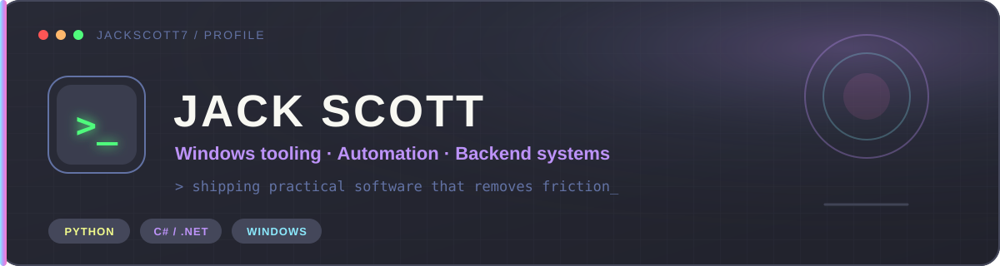

I build practical software that removes recurring friction: misplaced windows,
awkward scheduling on Windows, repetitive typing, and unreliable game-server
routes.

> **Predictable behavior. Clear interfaces. Useful documentation. Software people can actually install.**

## Featured projects

### [Centre](https://github.com/JackScott7/centre)

Captures and restores Windows application positions and sizes with per-display
presets and global hotkeys.

### [WinCron](https://github.com/JackScott7/wincron)

Runs crontab-style jobs as a native Windows service with live configuration
reload, overlap policies, and structured logs.

### [PingRadar](https://github.com/JackScott7/PingRadar)

Measures Steam relay latency, jitter, packet loss, and route quality before you
launch a multiplayer game.

### [IntelliText](https://github.com/JackScott7/IntelliText)

Expands text and runs keyboard-triggered actions anywhere on Windows.

## Technology stack

Technologies I have used in shipped projects, deployment work, or earlier
hands-on work. The badges show experience, not equal depth in every tool.

### Languages

### Frameworks and UI

### Python libraries and data tooling

### Infrastructure and deployment

### Services and packaging

### Databases

### Networking and system administration

## Open to

Remote software engineering roles and open-source collaboration involving:

- Python backend development and APIs
- Windows desktop and system tooling
- Automation, CLIs, and developer infrastructure

---

Code that removes friction.

